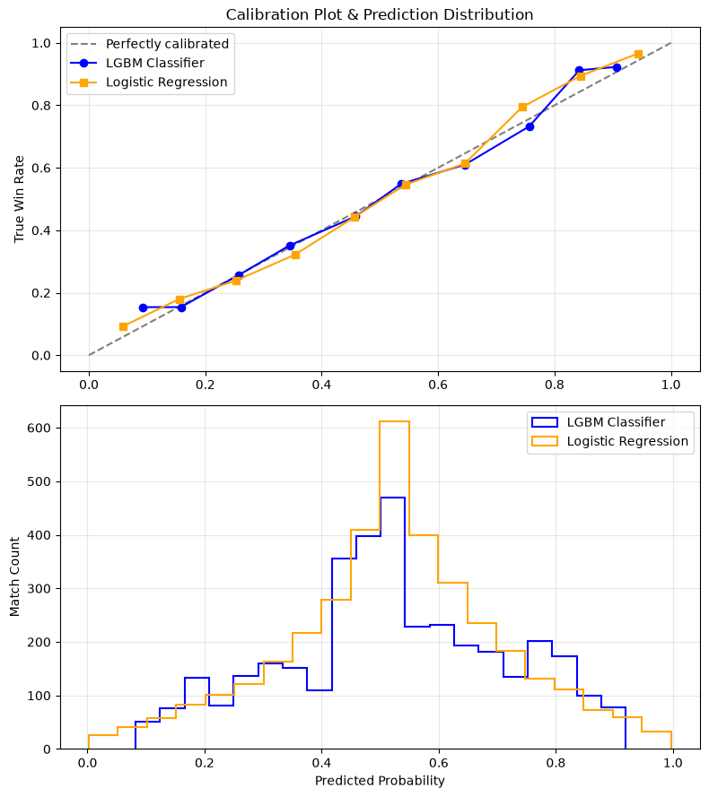

# Chess Match Win-Probability & Calibration Engine

An end-to-end, object-oriented machine learning pipeline that estimates early-game win probabilities and evaluates probability calibration on **19,108 real Lichess matches**.

## Project Architecture

* `features.py`: `ChessDataLoader` (data cleaning & target encoding) and stateless `FeatureExtractor` (Elo deltas, rating interactions, early castling `O-O` detection, premature queen movement flags, and fixed-category ECO encoding).
* `estimator.py`: `WinProbEstimator` encapsulating a regularized `LightGBM` classifier wrapped in 5-fold Platt Scaling (`CalibratedClassifierCV`) with single-match inference (`predict_match`).
* `main.py`: End-to-end training, Brier Score evaluation, and single-game inference demo.
* `notebooks/`: Exploratory data analysis, reliability diagrams, and residual slice diagnostics.

## Benchmark Results (Test Set Brier Score)

| Model Configuration | Features | Test Brier Score | Notes |
| :--- | :---: | :---: | :--- |
| **Logistic Regression (Baseline)** | 1 (`elo_diff`) | **0.21110** | Matches theoretical logistic Elo formulation |
| **LightGBM (Default)** | 7 | 0.21207 | Overfits low-SNR opening/move features |
| **LightGBM (Regularized)** | 7 | 0.21194 | Constrained with `max_depth=5`, `num_leaves=7`, `min_child_samples=100`, `learning_rate= 0.05`, `n_estimators=150`, `random_state=42`, `verbose=-1` |
| **Calibrated LightGBM (Sigmoid)** | 7 | **0.21168** | Post-hoc Platt Scaling improves probability reliability & sharpness |

## Key Quantitative Insights

1. **Signal-to-Noise Ratio & Regularization:** Because Lichess Elo ratings already follow a logistic win-probability curve, unconstrained gradient boosted trees overfit noise in opening features. Constraining tree complexity prevents variance explosion.
2. **Probability Calibration & Sharpness:** While Logistic Regression achieves a slightly lower global Brier Score, the calibrated LightGBM model captures non-linear interactions (e.g., rating tier + early castling) and produces a wider dynamic prediction range (`0.00` to `1.00`).
3. **Irreducible Bayes Error:** Residual slice analysis on the Top 10 highest-error matches reveals structural tail events—primarily provisional/smurf accounts with lagging Elo ratings and bullet/blitz timeouts.



## Quick Start

1. Install dependencies:
   ```bash
   pip install -r requirements.txt

2. Download the Lichess Games Dataset and place games.csv in the project root directory.

3. Run the pipeline:
   ```bash
   python main.py

## Future Improvements (V2.0)

1. Integrate python-chess to compute mid-game material balance and king safety metrics.

2. Incorporate player Rating Deviation (RD) to filter out provisional accounts.

